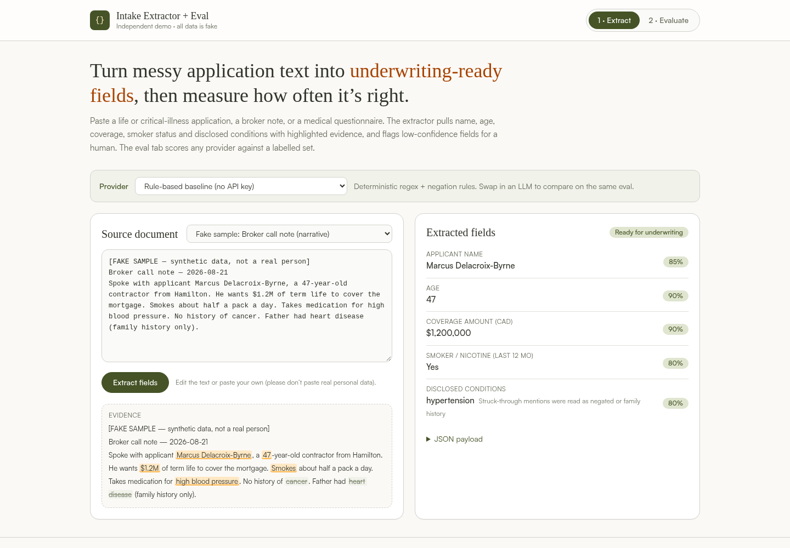

# Intake Extractor + Eval

**Live demo:** https://minaelzek.github.io/policyme-demo/  ·  **Repo:** https://github.com/minaelzek/policyme-demo

> Independent demo by Mina Elzek — not affiliated with PolicyMe. Every applicant, document and number in this repo is fictional.



## Problem

Insurance intake arrives as messy text: application forms, broker call notes, paramedical notes, client emails, chat transcripts. Before anyone can quote or underwrite, someone has to pull out the same handful of facts (who, how old, how much coverage, nicotine use, what conditions they disclosed). AI extraction can do that, but only if you can **see the evidence** and **measure how often it's right** before you trust it in production.

## What it does

1. **Extract**: paste a document (or pick one of 12 fake samples) and get structured fields:
   `fullName`, `age`, `coverageAmount` (CAD), `smoker` (any tobacco/nicotine/vaping in the last 12 months), `conditions`.
   - Each value is highlighted in the source text as evidence.
   - Negated mentions ("denies hypertension", "Cancer? N") and family history ("father had heart disease") are struck through and **not** counted.
   - Age is computed from DOB at the application date when no age is stated. "Quit 6 months ago" counts as a smoker, "quit 3 years ago" does not.
   - Low-confidence or missing fields are flagged **Needs review** (human in the loop).
2. **Evaluate**: run the selected provider over the labelled set and get per-field accuracy, exact-match documents, condition precision/recall/F1, and a list of every miss. You can download `predictions.json` too.
3. **Pluggable providers** (`src/lib/extract/`):
   - `mock`: deterministic rule-based baseline. It's the default and needs no key. Current score: **96.7% field accuracy, 10/12 docs fully correct**. The two misses are deliberate hard cases ("maybe half a million?", a name that only appears in an email subject line).
   - `llm`: any OpenAI-compatible `/chat/completions` endpoint, called straight from the browser with a key you type in. The key is kept in memory only and never stored. Output is validated against a closed condition vocabulary.

Adding a provider means implementing one interface:

```ts
interface ExtractorProvider { id: string; label: string; extract(text: string): Promise<Extraction> }
```

## Run locally

```bash
npm install
npm run dev        # http://localhost:5173/policyme-demo/
npm test           # Vitest: extractor rules, eval maths, LLM provider (mocked fetch)
npm run build      # static site in dist/
```

Optional Python scorer (stdlib only). It scores predictions from any backend pipeline, such as a LangChain or LangGraph job, against the same labels:

```bash
python3 scripts/score.py predictions.json
```

## Tech

React 19 · TypeScript · Vite · Tailwind CSS v4 (design tokens in `src/styles/tokens.css`) · Vitest · GitHub Actions → GitHub Pages. It's a fully static site with no backend.

```
src/
  lib/extract/mock.ts   rule-based extractor (regex + negation/family-history scope)
  lib/extract/llm.ts    OpenAI-compatible provider + JSON validation
  lib/eval.ts           scoring: per-field accuracy, exact match, P/R/F1
  data/samples.json     12 labelled FAKE documents
  App.tsx               Extract + Evaluate UI
scripts/score.py        same metrics in Python
```

## Deploy

Push to `main` on `github.com/minaelzek/policyme-demo`, then set **Settings → Pages → Source: GitHub Actions**. `.github/workflows/deploy.yml` tests, builds and publishes to `https://minaelzek.github.io/policyme-demo/`. The Vite `base` is already `/policyme-demo/`.

## Notes

- Colours are matched to PolicyMe's public site palette for the purpose of the demo. No PolicyMe logos or trademarks are used, and nothing here is an official PolicyMe product.
- Please don't paste real personal or health information into the demo.
